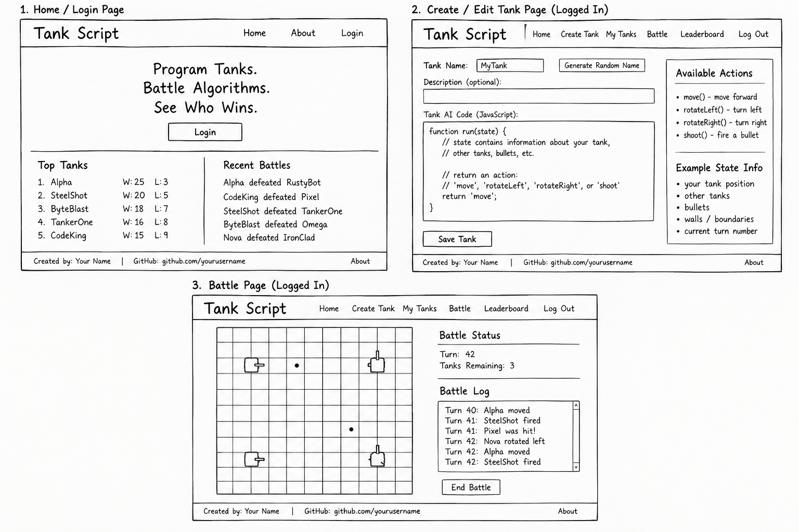

# TankScript

[My Notes](notes.md)

Created by Hadden Smith. [GitHub repository](https://github.com/HaddenSmith/TankScript)

TankScript is a web-based programming game where users create JavaScript, TypeScript, or Python algorithms to control tanks and compete against tanks programmed by other users.

### Run locally

From the repository root, run `npm install`. With the private MongoDB configuration in `backend/dbConfig.json`, run `npm run dev:backend` in one terminal and `npm run dev` in another. Vite proxies `/api` to Express on port 4000 and forwards `/ws` WebSocket connections with `ws: true`.

- `frontend/src/` contains the React app, Monaco editor, Battle page, and Debugger. Its `game/` directory contains BattleEngine, the official tanks, the TankScript API, and QuickJS/Pyodide worker adapters. Vite copies `frontend/public/` to the site root.
- `backend/` contains Express and MongoDB access for accounts, authentication, and saved and community tanks, plus the WebSocket server for online counts.
- `tests/` contains the [test suites and browser tools](tests/README.md).

`npm run build` produces `dist/`. All battles run in the browser.

### Tank languages

The Tank Editor supports JavaScript, TypeScript, and Python, with separate drafts while switching languages. Java appears as coming soon for normal users. Saving stores the selected language and original source; older tanks without a language field default to JavaScript.

Java is available experimentally with the reviewed TeaVM assets and `VITE_EXPERIMENTAL_JAVA=true` in development. For saving/loading, the backend also requires `NODE_ENV=development` and the same opt-in flag. Java tanks save their original source with `language: "java"` through the normal authenticated tank system; no compiled WebAssembly is stored. The editor provides a `MyTank` starter, Java highlighting, TankScript API suggestions and compiler markers after **Generate Command**. Incomplete drafts can still be saved.

Saved Java tanks work in the Debugger and mixed-language battles, with at most **four Java tanks per battle**. Local `.java` files can also be loaded without uploading them. Java compiles in the browser and runs in isolated Wasm workers using the same BattleEngine, retaining fields between ticks. Production builds ignore the flag and exclude Java runtime assets; the production API rejects Java writes and hides existing Java records. Public Java support remains disabled. See the [Java setup, isolation and remaining production requirements](frontend/src/game/tank-script/java/README.md).

Execution files live in `frontend/src/game/tank-script/`: `javascript/` contains QuickJS and the trusted fixture executor, `typescript/` contains compilation, `python/` contains Pyodide, isolated workers and runtime assets, `java/` contains the experimental TeaVM adapter, and `shared/` contains the API definitions, protocol and runner orchestration. TypeScript compiles to JavaScript and reuses QuickJS. Editor starter source modules live in `frontend/src/tank-editor/editor/starter-code/`.

The language selector uses the original SVG logos from [Devicon v2.18.0](https://github.com/devicons/devicon/tree/v2.18.0/icons), stored locally in `frontend/public/language-logos/`. Each SVG includes its source and the [MIT license](https://github.com/devicons/devicon/blob/v2.18.0/LICENSE). Artwork and brand colors are unchanged; the logos identify languages, whose trademarks belong to their respective owners. The yellow JS mark is the [JavaScript community logo](https://github.com/voodootikigod/logo.js).

Before a TypeScript tank runs, the official TypeScript compiler checks its syntax and types against the same API definitions used by Monaco, then emits JavaScript. Compilation happens in a separate worker with a timeout, and successful results are cached. The compiler loads only when needed; Vite prebundles it for development to prevent a first-use page reload. Standalone scripts are supported; imports, exports, modules, and external packages are not.

JavaScript and TypeScript execute through the existing QuickJS Web Worker. Python uses pinned [Pyodide](https://pyodide.org/en/stable/usage/webworker.html) 314.0.8, running real Python in a dedicated worker per Python tank. Its runtime assets load only when Python executes, are bundled locally, and are reused across starts. Each interpreter compiles its tank once and stays initialized between ticks. All languages use the same BattleEngine snapshots and commands in the Debugger and battles.

Python uses snake_case API names:

```python
for enemy in all_tanks:
    if enemy.id != tank_id and enemy.health > 0:
        if enemy.x > tank_position.x:
            move_right()
        else:
            shoot()
        break
```

Actions are `move_up()`, `move_down()`, `move_left()`, `move_right()`, `rotate_left()`, `rotate_right()`, and `shoot()`; the first action wins. State is `tank_id`, `tank_position`, `tank_rotation`, `tank_health`, `all_tanks`, `all_bullets`, `arena_width`, and `arena_height`. Tank/bullet collections are read-only tuples of records with dot-access fields; bullet owners use `owner_id`. Python variables persist for that tank during a battle. Syntax and runtime errors are checked in the Debugger/Battle; saving keeps drafts without loading Python.

Python workers run behind opaque-origin frames with a restrictive content policy that blocks networking and dynamic JavaScript. Import restrictions and empty JavaScript globals add defense in depth; they are not a Python security boundary by themselves. Supported imports are `math`, `random`, `statistics`, `collections`, `itertools`, `functools`, and `operator`. Scripts are synchronous; external packages and printed output are not supported.

Python checks a 100 ms execution budget. A 500 ms worker watchdog handles code that cannot be interrupted, disables that tank until restart, and lets healthy tanks continue. Python has a larger startup/download and memory cost than QuickJS, and browser execution cannot provide QuickJS's per-tank heap limit. Large allocations can still put pressure on the tab. Frames, workers, and ports are cleaned up on cancellation/reset. Experimental Java uses another adapter behind the same snapshot/command interface, with its existing restrictive CSP and external deadlines; it also lacks a hard garbage-collected heap quota.

### Live online-user counter

The navigation bar shows a live count such as `3 online`, with a green connection indicator and a disconnected state. It counts connected browser tabs, so opening two tabs adds two connections. The reusable `OnlineUserCount` component retries a lost connection up to three times after 1, 2, and 4 seconds, and closes its socket and clears pending retries when it unmounts.

### Elevator pitch

You do not steer your tank—you program it. Write a strategy, save it as a community tank, then watch it compete in a 2D arena against other saved tanks or five official tanks spanning Easy through Overkill.

### Design



The application will have several main views, including a home/login page, a tank programming page, a battle arena, and a leaderboard.

The tank editor allows users to create a tank, give it a name, and write the JavaScript, TypeScript, or Python algorithm that controls its behavior.

The battle arena will display a 2D grid containing the competing tanks. As the simulation runs, users will be able to watch tanks move, rotate, and fire in real time.

### Key features

- Register, log in, and log out of an account.
- Create and name programmable tanks.
- Write JavaScript, TypeScript, or Python algorithms that control a tank's decisions.
- Save and edit tank programs.
- Select tanks and run battles between them.
- Watch tank battles play out on a 2D grid.
- Allow tanks to move, rotate, and shoot based on their programmed algorithms.
- Track wins and losses for tanks (future work).
- View a leaderboard of tanks created by different users (future work).
- Watch battles update in real time.
- See the live number of connected browser tabs in the navigation bar.

### Technologies

I am going to use the required technologies in the following ways.

- **HTML** - Provides the basic structure of the application, including the login interface, navigation, tank editor, battle arena, tank information, and leaderboard.
- **CSS** - Styles the application and makes it responsive to different screen sizes. CSS will also be used to visually represent the battle grid, tanks, bullets, directions, and animations such as tanks moving and firing.
- **React** - Provides reusable components for parts of the application such as the tank editor, battle arena, tank cards, login interface, and leaderboard. React routing will switch between the application's different views, and React will update the interface as users edit tanks and watch battles.
- **Service** - The backend service provides endpoints for authentication and tank CRUD. The Tank Editor uses the [CueName Fantasy Name Generator API](https://cuename.com/developers) for optional, user-triggered suggestions of five tank names; suggestions remain editable before saving.
- **DB/Login** - MongoDB persists user accounts, bcrypt password hashes, session tokens, and saved tank programs. Battle history and statistics are future work.
- **WebSocket** - The backend pushes online connection counts to the React navigation bar through `/ws`.
- **Future work** - Move battle execution to an authoritative backend using isolated, resource-limited containers, and support multiplayer battles and live spectating.

## 🚀 Specification Deliverable

> [!NOTE]
> Fill in this sections as the submission artifact for this deliverable. You can refer to this [example](https://github.com/webprogramming260/startup-example/blob/main/README.md) for inspiration.

For this deliverable I did the following. I checked the box `[x]` and added a description for things I completed.

- [x] **I completed the prerequisites for this deliverable** - I completed the required prerequisite work and committed my startup specification to Git.
- [x] **Proper use of Markdown** - I used headings, lists, links, images, and other Markdown formatting throughout my README.
- [x] **A concise and compelling elevator pitch** - I created an elevator pitch describing TankScript and its competitive programming concept.
- [x] **Description of key features** - I documented user accounts, programmable tanks, battles, saved tanks, leaderboards, and realtime battle updates.
- [x] **Description of how I will use each technology** - I described my planned use of HTML, CSS, React, backend services, authentication, the CueName third-party API, database storage, and WebSocket.
- [x] **Rough sketches of the application** - I created and embedded a design showing the planned home/login page, tank editor, and battle arena.

## 🚀 AWS deliverable

For this deliverable I did the following. I checked the box `[x]` and added a description for things I completed.

- [x] **Rented EC2 server** - I created and rented my own EC2 server from AWS.
- [x] **Leased domain name** - I used Route 53 to rent a domain name.
- [x] **Server accessible** from my domain: [https://HaddenSmith.com](https://HaddenSmith.com) - The webpage is published and secure.

## 🚀 HTML deliverable

For this deliverable I did the following. I checked the box `[x]` and added a description for things I completed.

- [x] I completed the prerequisites for this deliverable (Simon deployed, GitHub link, Git commits).
- [x] **HTML pages** - I created separate HTML pages for the major components of TankScript, including Home, Login, Tank Editor, Battle, and About.
- [x] **Proper HTML element usage** - I used semantic HTML elements including `body`, `header`, `nav`, `main`, `section`, and `footer` to organize the application.
- [x] **Links** - I added consistent navigation links between all of the application pages, along with a prominent link to my GitHub repository.
- [x] **Text** - I added application content explaining TankScript, how the game works, and the basic workflow for creating and battling programmed tanks.
- [x] **Third-party API** - The Tank Editor's Suggest Names control optionally requests five tank names from the [CueName Fantasy Name Generator API](https://cuename.com/developers).
- [x] **Images** - I included my TankScript application image on the Home and About pages.
- [x] **Login placeholder** - I created a Login page with username/email and password inputs, a login button, account registration placeholder, and a placeholder for displaying the authenticated user's name.
- [x] **DB data placeholder** - I added placeholders for database-backed tank information on the Tank Editor page and battle history on the Battle page.
- [x] **WebSocket placeholder** - I added a live battle event area on the Battle page to represent future realtime WebSocket communication for tank movements, shots, hits, and battle events.

## 🚀 CSS deliverable

For this deliverable I did the following. I checked the box `[x]` and added a description for things I completed.

- [x] I completed the prerequisites for this deliverable (Simon deployed, GitHub link, Git commits).
- [x] **Visually appealing colors and layout. No overflowing elements.** - I created a consistent Blueprint Programmer color scheme with blue, teal, light gray, and dark console colors, and tested the layout at different screen sizes.
- [x] **Use of a CSS framework** - I added Bootstrap 5.3.3 and used Bootstrap classes for form controls and buttons while keeping my custom TankScript styling.
- [x] **All visual elements styled using CSS** - I styled the navigation, footer, typography, links, page spacing, buttons, forms, and other visual elements with shared and page-specific CSS.
- [x] **Responsive to window resizing using flexbox and/or grid display** - I used Flexbox, Grid, and media queries to make the navigation, footer, and page layouts adapt to smaller screens.
- [x] **Use of a imported font** - I imported Chakra Petch and JetBrains Mono from Google Fonts and used them throughout the TankScript interface.
- [x] **Use of different types of selectors including element, class, ID, and pseudo selectors** - I used element, class, ID, child, and pseudo selectors such as `:hover` and `:focus-visible` throughout the stylesheet.

## 🚀 React part 1: Routing deliverable

For this deliverable I did the following. I checked the box `[x]` and added a description for things I completed.

- [x] I completed the prerequisites for this deliverable (Simon deployed, GitHub link, Git commits).
- [x] **Bundled using Vite** - I configured Vite and added `dev`, `build`, and `preview` npm scripts. The production build outputs the app to `dist/`.
- [x] **Converted the application to React** - The existing TankScript page content is rendered by React instead of separate page documents.
- [x] **Components** - I created separate Home, Login, Register, Tank Editor, Battle, and About view components.
- [x] **Router and navigation** - I added React Router routes for each view and use `NavLink` for internal application navigation, including a not-found route.
- [x] **Shared application layout** - The top-level `App` component provides the shared header, navigation, and footer around the routed views. Unknown routes show a not-found message and return to the home route after three seconds.
- [x] **Existing HTML and CSS** - I converted the previous page markup into React JSX components and preserved the TankScript content and page styling. The shared stylesheet is imported by the React app.
- [x] **Static assets** - I moved images used by the app into `frontend/public/` and reference them from the site root.
- [x] **Bootstrap** - I installed Bootstrap and React Bootstrap, and import Bootstrap CSS once in the app. The pages use Bootstrap classes for forms, buttons, and the battle table; they do not currently use React Bootstrap components.
- [x] **Deployment setup** - `deployWebsite.sh` packages the Vite bundle and Express server for the `startup` service.

## 🚀 React part 2: Reactivity deliverable

For this deliverable I made TankScript interactive with React state and lifecycle behavior.

- [x] **React components and hooks** - The startup is built from multiple React components. `useState` manages interactive UI state, and `useEffect` handles lifecycle work such as loading saved tanks and managing the battle timer.
- [x] **Tank editing** - The Tank Editor creates, selects, edits, saves, and deletes tanks through the backend service API. MongoDB persists saved tanks, and authentication uses an HTTP-only cookie.
- [x] **Reactive battles** - Players select saved or built-in tanks and configure arena size, starting health, tick speed, and tank colors. Battles execute saved TankScript source through the documented action/state API and render changing tank and bullet snapshots.
- [x] **Automatic updates** - The browser advances battles at the selected speed, updates the display after each tick, and stops when a result is returned.
- [x] **Results and safe execution** - Completed battles display a winner or tie. Battle and Debugger scripts run in QuickJS Web Workers with execution time, memory, and stack limits.

## 🚀 Service deliverable

For this deliverable I did the following. I checked the box `[x]` and added a description for things I completed.

- [x] I completed the prerequisites for this deliverable (Simon deployed, GitHub link, Git commits).
- [x] **Node.js/Express HTTP service** - I added the Express service, which serves the frontend on port 4000.
- [x] **Static middleware for frontend** - Express serves the built frontend, and Vite proxies local API requests to port 4000.
- [x] **Backend service endpoints** - I added registration, login, logout, current-user, and protected tank CRUD endpoints.
- [x] **Registration, login, logout, and restricted endpoint** - Users can register, log in by username or email, log out, and restore their current-user session.
- [x] **BCrypt password hashing** - I hash account passwords with bcrypt and authenticate sessions with an HTTP-only cookie.
- [x] **Tank ownership** - Protected tank endpoints restrict access to each user's own tanks.
- [x] **Frontend calls service endpoints** - Authentication and tank persistence use centralized helpers in `frontend/src/services/api.js` instead of `localStorage`.
- [x] **Third-party API** - The Tank Editor offers responsive five-name suggestions from the [CueName Fantasy Name Generator API](https://cuename.com/developers), with attribution on the About page.
- [x] **Build and service flows** - I built the frontend and tested registration, login, sessions, and tank ownership and CRUD flows.

## 🚀 DB deliverable

For this deliverable I did the following. I checked the box `[x]` and added a description for things I completed.

- [x] I completed the prerequisites for this deliverable (Simon deployed, GitHub link, Git commits)
- [x] **Stores data in MongoDB** - MongoDB persists users and community tanks; tank CRUD and persistence across a service restart were verified using an isolated test database.
- [x] **Stores credentials in MongoDB** - User records, bcrypt password hashes, and session tokens are stored in MongoDB. Raw passwords are not stored.

## 🚀 WebSocket deliverable

For this deliverable I did the following. I checked the box `[x]` and added a description for things I completed.

- [x] I completed the prerequisites for this deliverable (Simon deployed, GitHub link, Git commits)
- [x] **Backend listens for WebSocket connection** - I use the `ws` package and `WebSocketServer` attached to Express's HTTP server at `/ws`. A ping/pong heartbeat checks connections every 10 seconds and removes unresponsive clients.
- [x] **Frontend makes WebSocket connection** - `OnlineUserCount` connects with the browser's WebSocket API, using `ws` for HTTP and `wss` for HTTPS. It automatically retries lost connections with bounded delays. Vite's `/ws` proxy forwards local connections to port 4000.
- [x] **Data sent over WebSocket connection** - The server broadcasts JSON such as `{"type":"online-count","count":3}` to all open connections when a tab connects or disconnects.
- [x] **WebSocket data displayed** - The component's `onmessage` handler validates the message and updates React state. The navigation bar immediately renders the new count and connection status.
- [x] **Application is fully functional** - Local tests and the production build passed. Browser checks verified live counts across two tabs, reconnection after a server restart, and desktop and mobile navigation layouts.
